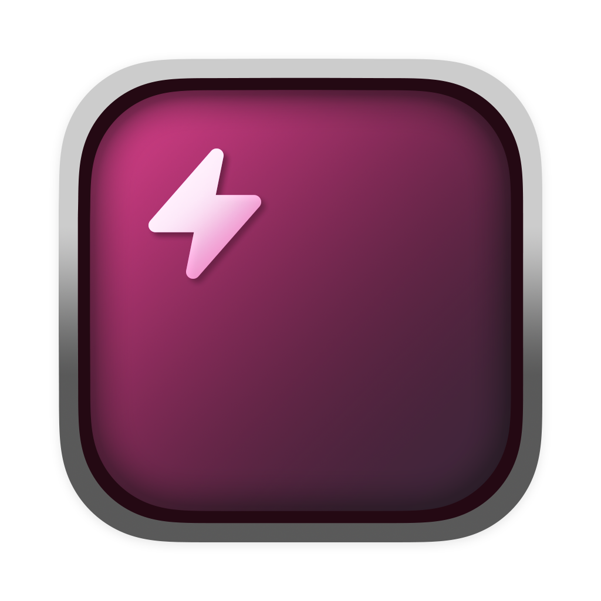

<div align="center">
  
</div>

<div align="center">
  <h1>TweakPHP</h1>
</div>

<div align="center">
  TweakPHP is a desktop application with a code editor to tweak your PHP code.
</div>

<div align="center">
  (TweakPHP is currently Beta)
</div>

<br>

<div align="center">
  
</div>

<div align="center">
  <a href="https://github.com/tweakphp/tweakphp/releases">Download Now</a> | <a href="https://tweakphp.com/">Documentation</a> | <a href="https://discord.gg/Et3UTT4xwC">Discord</a>
</div>

## Installation

### Quick Install (macOS & Linux)

Install the latest release from the terminal:

```bash
curl -fsSL https://raw.githubusercontent.com/tweakphp/tweakphp/main/install.sh | bash
```

The script picks the best package for your system: the native `.deb`/`.rpm` on Debian/Fedora-based distros, the AppImage elsewhere (extracted automatically when `libfuse2` is missing), and the universal app bundle on macOS. Every download is verified against the release checksums. Run it with `--help` for all options (`--version`, `--appimage`, `--uninstall`, ...).

### macOS

#### Homebrew

```bash
brew install tweakphp/tap/tweakphp
```

#### DMG File

Download the `.dmg` file from the [releases page](https://github.com/tweakphp/tweakphp/releases) and drag TweakPHP to your Applications folder.

### Linux

#### Snap

```bash
snap install tweakphp
```

#### AppImage

1. Download the `.AppImage` file from the [releases page](https://github.com/tweakphp/tweakphp/releases)
2. Make it executable: `chmod +x TweakPHP-*.AppImage`
3. Run the AppImage

> **Ubuntu 24.04+:** AppImages need FUSE, which is no longer installed by default. Either install it (`sudo apt install libfuse2t64`), run the AppImage once with `--appimage-extract-and-run`, or use the [Quick Install](#quick-install-macos--linux) script, which installs without FUSE automatically.

#### RPM Package

Download the `.rpm` package from the [releases page](https://github.com/tweakphp/tweakphp/releases) and install it:

```bash
sudo rpm -i TweakPHP-*.rpm
```

#### Deb Package

Download the `.deb` package from the [releases page](https://github.com/tweakphp/tweakphp/releases)

#### Arch Linux (AUR)

```bash
yay -S tweakphp
```

or with any other AUR helper.

### Windows

Download the `.exe` installer from the [releases page](https://github.com/tweakphp/tweakphp/releases) and run it.
